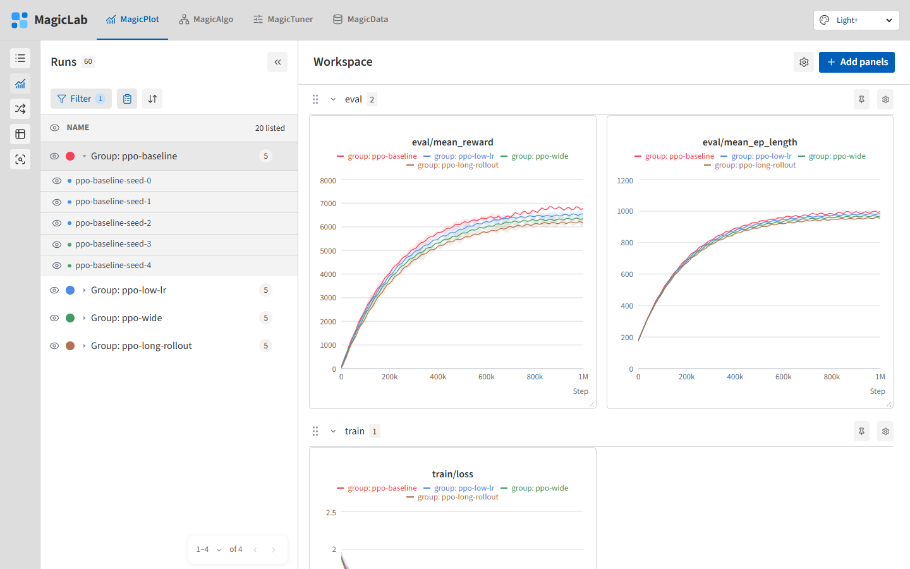
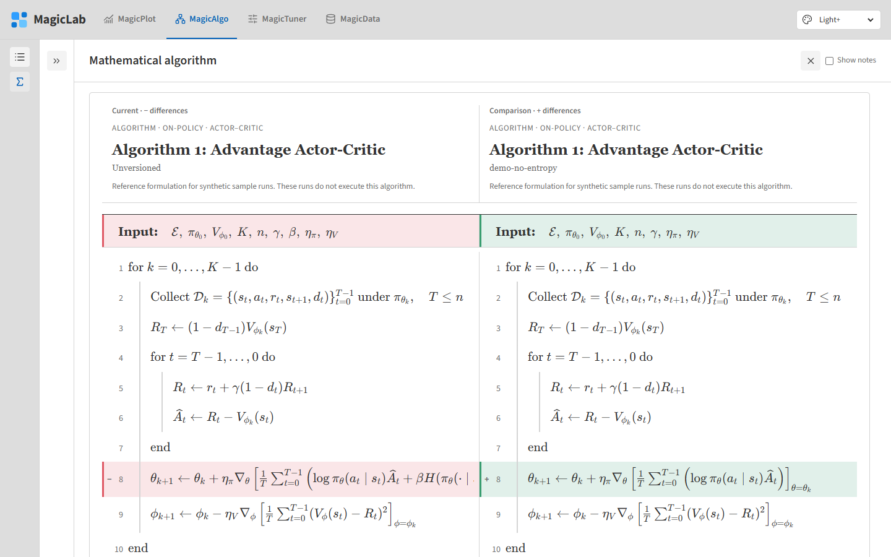
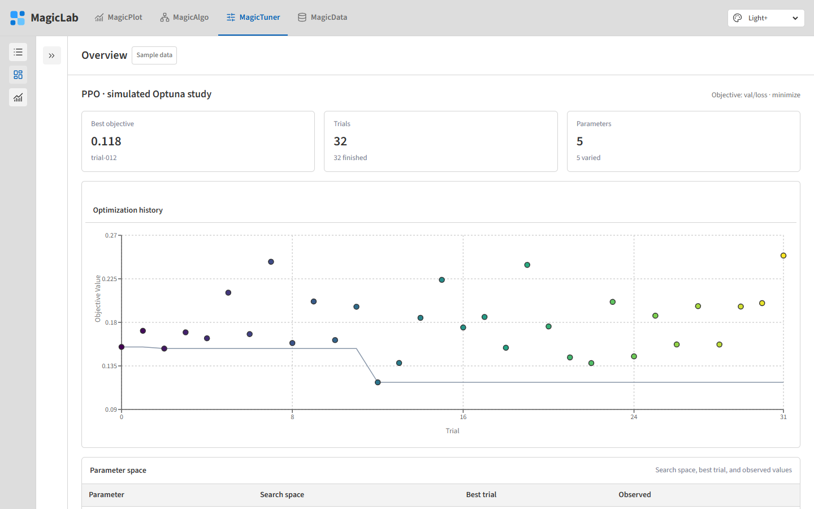
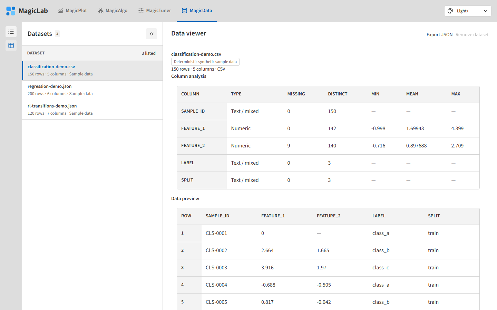

# MagicLab

**Build your own research dashboard, one project at a time.**

Install MagicLab inside your repository and adapt it to your data, preferences, and workflow. Start with a working interface, shared components and styles, and instructions that guide your coding agent through each change.

Each project gets its own copy. You decide what it becomes.



_An example starting layout with synthetic data._

[Watch the 53-second demo](dashboard/docs/media/magiclab-demo.webm) — filter runs, edit a chart, compare algorithms, and explore studies and datasets. Recorded with synthetic data; no audio.

## Try it

With **Node.js 24**, npm, and Git installed:

```sh
git clone https://github.com/RVenturelli01/magic-lab.git
cd magic-lab/dashboard
npm ci
npm run dev -- --host 127.0.0.1
```

Open **http://127.0.0.1:5173**. No account or API key is needed for the demo. Stop it with **Ctrl+C**.

## Examples included

MagicPlot, MagicAlgo, MagicTuner, and MagicData provide working examples for charts, algorithm documents, tuning studies, and datasets. Reuse and adapt what fits your project. The bundled data is synthetic; the app does not launch training or tuning jobs.

<details>
<summary>See more dashboard screenshots</summary>

**Algorithm comparison**



**Tuning study**



**Dataset inspection**



</details>

## Make it yours

From the MagicLab checkout root, copy it into a **new directory** in your existing research repository:

```sh
node dashboard/scripts/install-into.mjs /path/to/your-project/dashboard
```

The installer includes the source, styles, agent instructions, and verification tools. It refuses to overwrite an existing directory. Run `npm ci` and `npm run dev -- --host 127.0.0.1` inside the new copy. See the [installation guide](dashboard/docs/ADOPTION.md) for details.

Open your coding agent in that directory and give it a task:

```text
Read AGENTS.md and follow its rules and change workflow.
Adapt the dashboard for [my project], using [my data].
Add [feature] with [my preferences], then test it and visually review screenshots.
```

For example: “Add a view comparing validation loss across model sizes, grouped by dataset.” To connect experiment logs, use the included [data adapter guide](dashboard/docs/DATA_ADAPTER.md).

## Guidelines for your coding agent

The agent must read [AGENTS.md](dashboard/AGENTS.md) before changing the dashboard and follow these rules:

- **Minimum added entropy.** Reuse existing code, components, styles, and patterns first. Add only what the requested feature needs. New controls, dependencies, abstractions, or visual differences require a concrete reason.
- **Use the existing structure.** Find the closest implementation in the [architecture map](dashboard/docs/ARCHITECTURE.md) and follow the [style guide](dashboard/docs/STYLE_GUIDE.md).
- **Preserve existing work and data.** Keep changes focused, preserve saved state, and follow the [data adapter contract](dashboard/docs/DATA_ADAPTER.md) when connecting experiments. Keep synthetic data clearly labeled.
- **Verify before reporting completion.** Run the relevant checks, inspect actual screenshots, fix issues, and report anything still unverified.

The [required workflow](dashboard/docs/CHANGE_WORKFLOW.md) is:

**Define success → find what to reuse → implement → test → inspect screenshots → refine.**

From the dashboard directory, with the dev server running:

```sh
npm run check
npm run visual:install
npm run visual:check
```

`check` runs tests, TypeScript, and lint. `visual:install` downloads Chromium once; skip it if Chrome is available. The [browser script](dashboard/scripts/visual-check.mjs) saves desktop/mobile screenshots and an error report in `outputs/visual-check/`.

The agent must extend checks for new features and **open the screenshots**, compare with existing views, and repeat after fixes. A passing script is not visual approval. Follow the [visual review guide](dashboard/docs/VISUAL_VERIFICATION.md).

[Dashboard guide](dashboard/README.md) · [MIT License](LICENSE)
