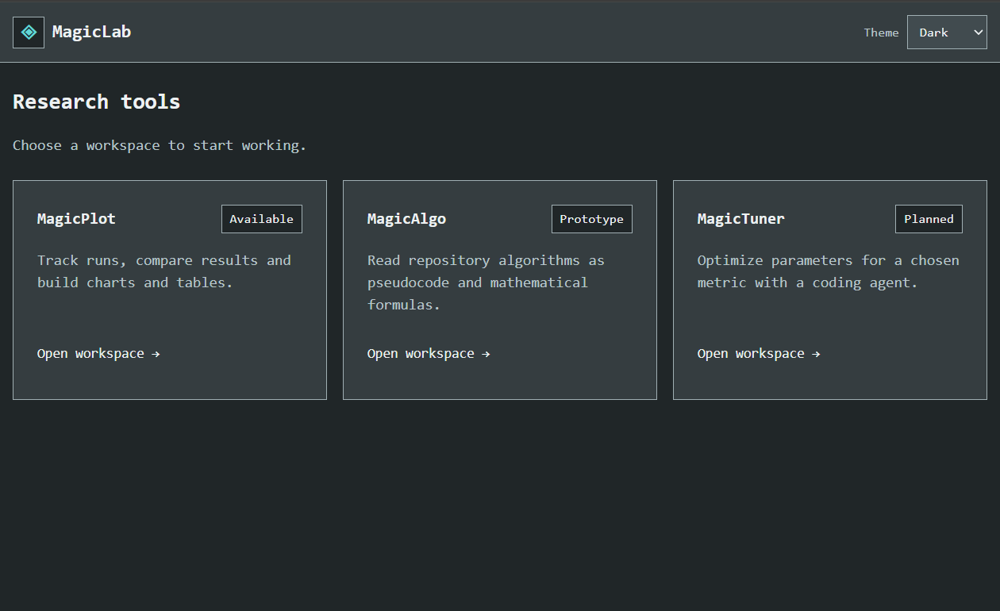
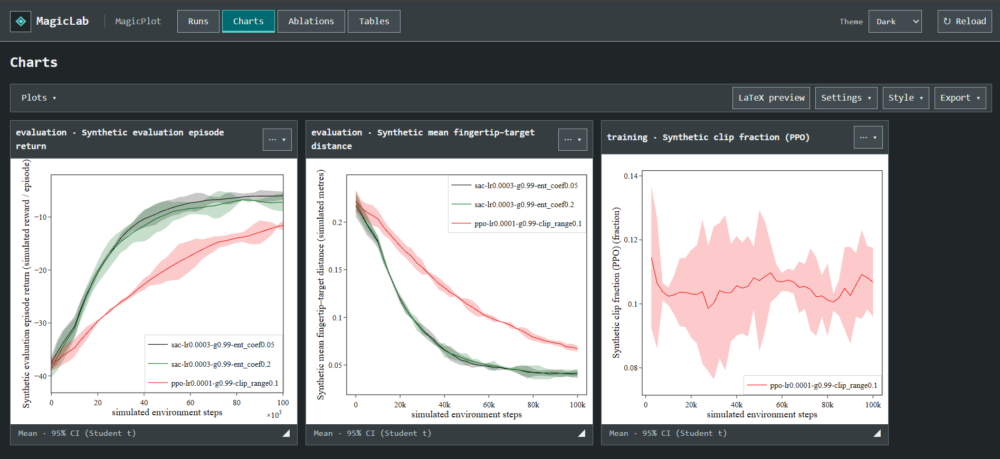
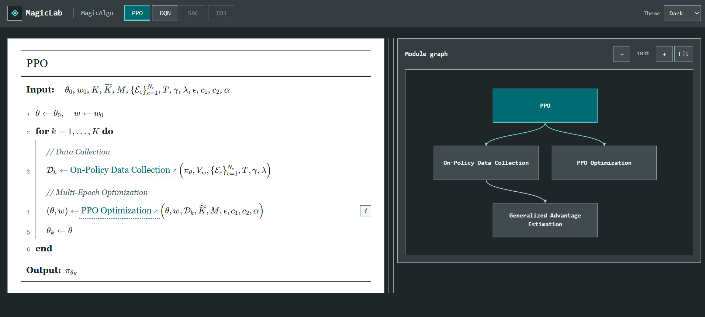

# MagicLab

**Ask. See. Understand.**

Research with a coding agent and a visual workspace side by side.

Split your screen: keep your **coding agent on one side** and the **MagicLab
dashboard on the other**. Give the agent your questions, instructions, and ideas.
Use the dashboard to visualize results, compare experiments, and understand
how your algorithms are implemented.


https://github.com/user-attachments/assets/d28f213b-b0db-402e-bd39-d7fabd0a7037


Want to change anything? **JUST ASK your coding agent.** A different analysis,
a clearer explanation, a new view, a feature, or a different style: describe
what you need, then explore it in the dashboard.

## Your starting tools

MagicLab gives you a set of starting tools to adapt with your coding agent.
Explore experiment results with MagicPlot, read algorithm descriptions with
MagicAlgo, and extend the workspace as your research needs evolve.



### MagicPlot — explore your results

Which experiment performed best? Did a change help across seeds? Which settings
made the difference?

Bring your local experiment results together and choose the runs you care about.

- **Filter and select runs** by configuration and metadata, then use the same
  selection across charts, ablations, and tables.
- **Compare learning curves** across experiments and seeds, with smoothing and
  configurable uncertainty bands.
- **Explore ablations** in a grid of plots with shared scales to see how settings
  affect your results.
- **Summarize results in tables** with means, standard deviations, and seed counts.
- **Style your figures** with custom labels, colors, legends, dimensions, and axis
  ranges; save views to revisit your analysis.
- **Export for papers and presentations** as SVG, PNG, PDF, CSV, or standalone
  LaTeX. Preview compiled LaTeX with a local installation of `pdflatex`.



_Example: compare learning curves and see how much results vary._

### MagicAlgo — explore the ideas behind your code

How does your algorithm work? What happens inside each step? How do the pieces
connect?

Read a mathematical description alongside an interactive map.

- **Read mathematical pseudocode** with typeset formulas, symbolic inputs and
  outputs, numbered steps, and nested loops.
- **Follow module calls** from the main algorithm into detailed substeps, then
  return through the breadcrumbs.
- **Explore the module graph** to see how the pieces connect, with pan, zoom,
  and a highlight for the module you are reading.
- **Look up symbols and step notes** through contextual explanations beside
  the document.
- **Switch between algorithm descriptions** and resize the document and graph
  panes to suit your reading workflow.



_Example: follow PPO from the big picture into data collection and optimization._

### MagicTuner — planned parameter tuning

MagicTuner is a placeholder for a future workspace to explore parameter choices
with a coding agent. A tuning workflow is not implemented yet. Today, use
MagicPlot to compare the results of experiments you have already run.

## Make it yours

1. **Download this repository** and copy the [`magic_lab`](magic_lab/README.md)
   folder into your own project.
2. **Open your coding agent** in your project and ask it to adapt MagicLab to
   your experiments and algorithms. Resolve any questions about your data together.
3. **Open the dashboard beside your coding agent** using the startup instructions
   your agent provides. Keep both visible as you ask questions and inspect results.

Start with this request:

> Adapt MagicLab to this project. Read its agent instructions and adaptation
> guide, connect my existing experiment results, and prepare interactive
> mathematical descriptions of my algorithms. Use the bundled examples as the
> starting style. Check the data and descriptions against my project, keep my
> original logs intact, and show me how to open the dashboard.

## JUST ASK

Once it is connected, every change starts with a request to your coding agent.
Use what you see in the dashboard to tell it what you need next:

- “Compare these experiments across seeds.”
- “Add a view that shows the effect of the learning rate.”
- “Prepare this figure for a two-column paper.”
- “Show me how this algorithm's update step works.”
- “Change the dashboard's style to match my preferences.”
- “Build my own Weights & Biases-style workspace with MagicLab: connect my local
  experiment logs, add the metrics and comparisons I care about, and let me save
  views and export figures for my papers.”

Ask the agent to make the change, reload the dashboard, and inspect the result.
Repeat as your questions evolve. MagicLab is a starting workspace you can shape
through conversation with your coding agent.

## Try it first

The bundled examples let you explore MagicPlot and MagicAlgo before connecting
your own project. They also give your agent a visual starting point to follow
or change at your request.

With [Node.js](https://nodejs.org/) 22 or newer installed, run these commands
from this repository's folder:

```sh
npm --prefix magic_lab ci
npm start
```

Then open [MagicLab in your browser](http://127.0.0.1:4173).

The examples use synthetic experiment results and illustrative PPO/DQN
descriptions. In your own project, your agent connects your actual data;
examples are only loaded when explicitly selected.

MagicLab runs locally, with no account required.

Ready to connect your project? Share the [adaptation guide](magic_lab/docs/ADAPTATION.md)
with your agent. For setup and development details, see the
[module guide](magic_lab/README.md).

Released under the [MIT license](magic_lab/LICENSE).
