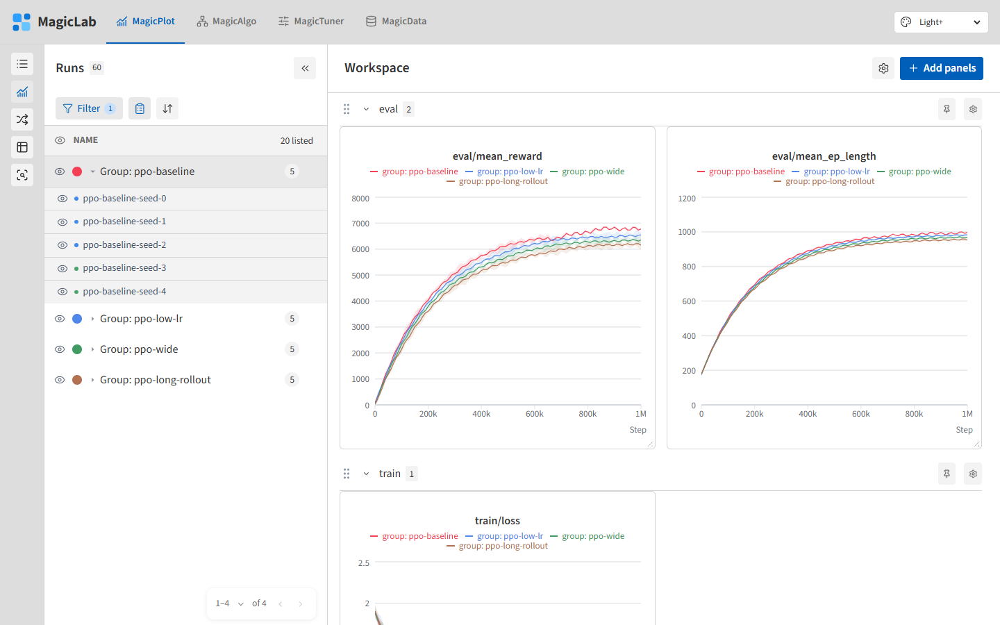

# MagicLab

**A starting point for your project's own dashboard.**

Adapt this application to your data, preferences, and workflow. Its shared components, styles, agent instructions, and verification tools travel with it into each research repository.



[Watch the 53-second demo](docs/media/magiclab-demo.webm) — a short walkthrough using synthetic data, without audio.

## Run

With **Node.js 24** and npm installed, run from this directory:

```sh
npm ci
npm run dev -- --host 127.0.0.1
```

Open **http://127.0.0.1:5173**. Stop with **Ctrl+C**. The demo needs no account or API key and uses synthetic data.

To copy MagicLab into another repository:

```sh
node scripts/install-into.mjs /path/to/your-project/dashboard
```

Choose a new directory; existing destinations are never overwritten. Run the same startup commands inside the copy. See [ADOPTION.md](docs/ADOPTION.md) for installation details.

## Customize with an agent

Open your agent in this directory and start with:

```text
Read AGENTS.md and follow its rules and change workflow.
Build [feature] for [project], using [data] and [my preferences].
Test the change and open desktop/mobile screenshots to review and refine it.
```

**Minimum added entropy is a mandatory rule for every agent change.** [AGENTS.md](AGENTS.md) requires the agent to find and reuse existing code, components, styles, and patterns before adding anything new. Add only what the task needs. New controls, dependencies, abstractions, and visual differences need a concrete requirement.

Use the [architecture map](docs/ARCHITECTURE.md) to find where a change belongs and the [style guide](docs/STYLE_GUIDE.md) to keep it consistent. For experiment logs, implement `DashboardDataAdapter` and select it in `lib/data/index.ts`; follow the [data adapter guide](docs/DATA_ADAPTER.md). Keep file access and credentials on the server.

## Verify each change

Follow the [change workflow](docs/CHANGE_WORKFLOW.md): **define success → reuse → implement → check → inspect screenshots → refine**.

```sh
npm run check
```

This runs tests, TypeScript, and lint. For changes affecting compilation or production behavior, stop the dev server and run `npm run build` too.

For visual review, keep the dev server running and use a second terminal:

```sh
npm run visual:install
npm run visual:check
```

Skip `visual:install` if Chrome is already installed. The [capture script](scripts/visual-check.mjs) checks interactions and saves desktop/mobile PNGs and `report.json` under `outputs/visual-check/`.

**Extend the script for new features. Open the images, compare with existing views, fix problems, and repeat.** A successful script is not visual approval. See [VISUAL_VERIFICATION.md](docs/VISUAL_VERIFICATION.md), including targeted dataset and sidebar checks.

## Explore the starting views

- **MagicPlot:** filter runs, open Workspace, and click a chart title to edit it.
- **MagicAlgo:** select an algorithm/version, read its formulation, or compare versions.
- **MagicTuner:** select a study, inspect its overview, and compare trial histories.
- **MagicData:** import CSV/flat JSON or select a sample, then open Data viewer.

These are examples to extend. The app does not launch training or tuning jobs. Dataset imports stay in browser storage, separate from experiment histories; keep your original files. View preferences also persist in the browser.

[Agent instructions](AGENTS.md) · [Installation](docs/ADOPTION.md) · [Chart guide](docs/CHARTS.md) · [MIT License](LICENSE)
