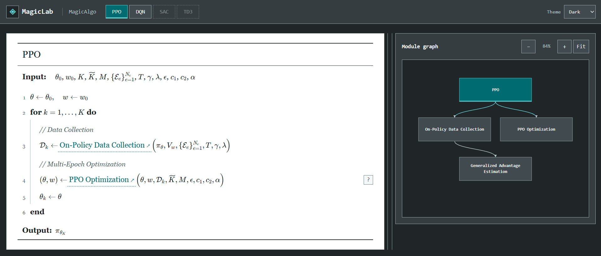
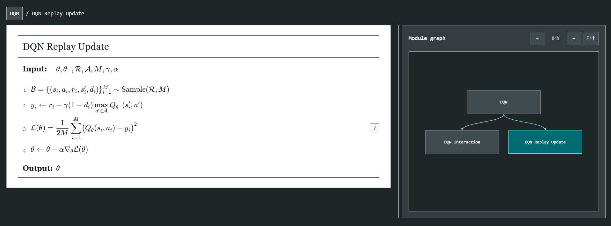
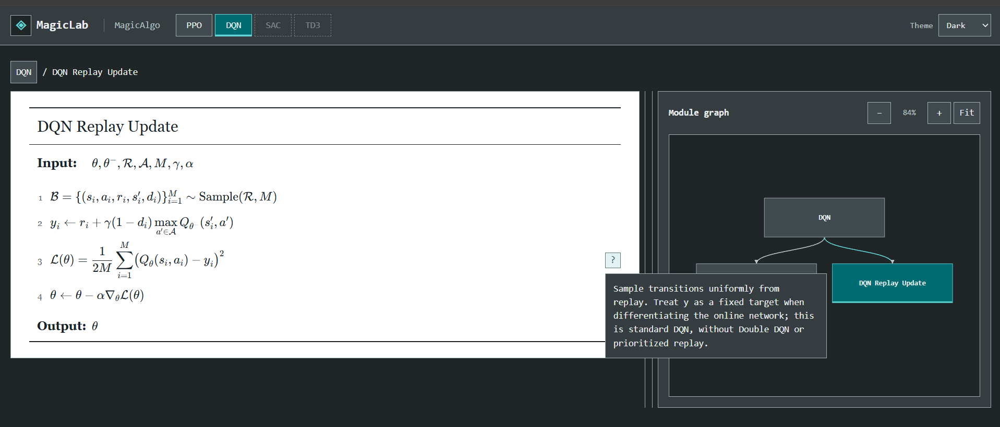
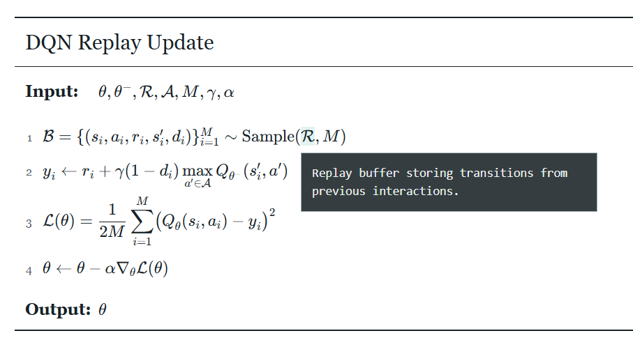

# MagicAlgo design

Read the [shared design](../DESIGN.md) first. This guide owns the mathematical
reading surface, graph and contextual help. The embedded Dark screenshots were
supplied on October 10, 2026; dimensions describe files, not verified viewports.

## Main implemented features

- Validated authored algorithm documents loaded independently of MagicPlot datasets.
- Main algorithm tabs, unavailable inventory entries, nested module calls and ancestor navigation with restored focus/reading position.
- Locally rendered KaTeX formulas and accessible MathML, symbolic inputs/outputs, numbered instructions, comments and nested loops.
- Directed module-call graph with current-node highlighting and shared-module caller information.
- Pointer/keyboard graph pan, anchored zoom, Fit and per-main-algorithm camera state.
- Pointer/keyboard document/graph separator resizing and stacked narrow-screen layout.
- Symbol glossary and contextual step notes accessible through hover, focus or click, with Escape dismissal.
- Explicit missing/loading/error states and retry; authored content validation rejects invalid references and cycles.

The viewer does not scan implementation source, execute training or verify that
an authored description matches the host algorithm. Adaptation requires checking
that correspondence against actual code.

## Writing style

Apply the [shared writing rules](../DESIGN.md#writing-style). Use mathematical
pseudocode rather than a prose tutorial in every row.
Inputs and outputs are symbolic; assignments and equations use consistent notation.
Keep the root concise and delegate formulas/details to named module calls. Use short
section comments and consistent loop/condition keywords. Define symbols in the
glossary using clear English, and add sparse notes for consequential conventions.
Module titles identify their operation; breadcrumb labels reuse those titles.
Distinguish hypothetical examples, unready entries and verified host descriptions.
Help text explains the selected symbol or step without repeating the whole algorithm.

## Reference examples

Use [examples/magicalgo](../../examples/magicalgo/README.md) alongside this guide:

- [algorithms.json](../../examples/magicalgo/algorithms.json): the complete PPO/DQN catalogue displayed in examples mode.
- [ppo-document.mjs](../../examples/magicalgo/ppo-document.mjs) and [dqn-document.mjs](../../examples/magicalgo/dqn-document.mjs): formulas, loops, module calls, glossary and notes.
- [algorithm-documents.mjs](../../examples/magicalgo/algorithm-documents.mjs): minimal documents and two main algorithms sharing a module.

Open with `npm --prefix magic_lab start -- --examples`. Reuse the presentation
and document structure, then author verified descriptions of actual host algorithms
outside the module. These references are hypothetical and execute no training.
PPO, DQN and module names are illustrative content. The
[document contract](../ALGORITHMS.md) owns format and validation rules.

## Reading surface and layout

The frame retains workstation styling. The document is white with `#182126`
text and `Georgia, Times New Roman, serif`. Body text is 19 px with 1.65 line
height; the title is 24 px. Preserve this reading typography instead of applying
the frame's monospaced font. Use local KaTeX formulas, symbolic Input/Output,
numbered instructions, vertical loop guides and 24 px indentation.

Numbers align with the instruction's first baseline, including tall sums and
fractions. Input, output and formulas have natural height and may wrap. There
are no internal document scrollbars. Use italic comments and teal inline module
links with dashed underlines. Content organization follows the writing rules above.

Place the document left and graph right with aligned upper borders and a
keyboard-accessible resizable separator. Stack below 900 px. The graph uses
shared workstation tokens; pan/zoom transforms keep nodes and edges aligned.
The separator supports ArrowLeft/ArrowRight, Home/End for width bounds and Escape
to cancel a drag, as well as pointer cancellation.

_1917 x 817 px. Main algorithms appear in the compact header with teal selection
and attenuated unavailable entries. The document has horizontal separators and
numbered nested instructions; graph nodes are rectangular with directed edges
and zoom/Fit controls. Example algorithm names do not constrain the product._

## Navigation and graph

Main algorithms appear beside MagicLab and MagicAlgo in the header using shared
rectangular navigation controls. Submodules do not appear there. Unready entries
are attenuated and explicitly unavailable. Keep the main algorithm highlighted
while exploring its modules. Breadcrumbs return to ancestors with focus and
reading position restored; the graph highlights the current module.

Keep pan, zoom and Fit controls accessible. Add no duplicate workspace headings
or permanent reading hints. A shared module may identify its immediate callers.
Arrow keys pan, plus/minus zoom and Home fits the graph. Focusing an offscreen
node brings it into view; pointer cancellation restores the previous camera.

_1917 x 712 px crop. The document preserves its natural height and first-baseline
alignment for tall formulas. Do not fill the blank area artificially. The main
application header is outside the crop._

## Contextual help

Symbol definitions open through hover, focus or click. Use a few small rectangular
question-mark controls, following the writing rules above. Help has
a dark uniform surface, thin border and light monospaced text, positioned within
the available space. Escape closes it; shared accessibility rules also apply.

_1917 x 820 px. A temporary explanation may overlap the reading surface without
creating a permanent panel. Keep step explanations distinct from formulas._

_907 x 498 px crop. A subtle highlight identifies the symbol and the nearby help
uses the same frame as step notes. This is a detail crop, not a mobile layout._

## Implementation and reference limits

[algorithms.css](../../web/algorithms.css) owns presentation,
[algorithms.mjs](../../web/ui/algorithms.mjs) renders the document and
[algorithm-graph.mjs](../../web/ui/algorithm-graph.mjs) renders graph elements.
These screenshots do not establish keyboard behavior, responsive correctness or
scientific validity. Light theme and narrow screens have no screenshot here.
