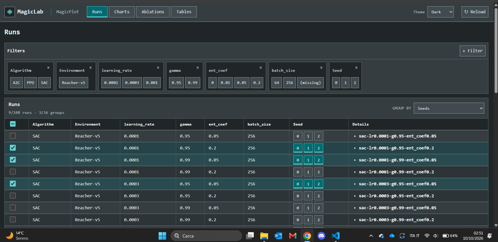
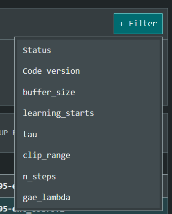
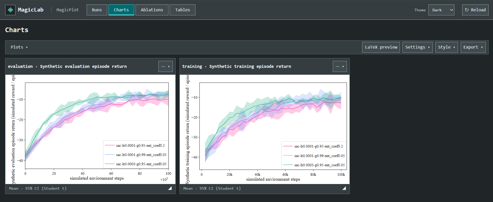
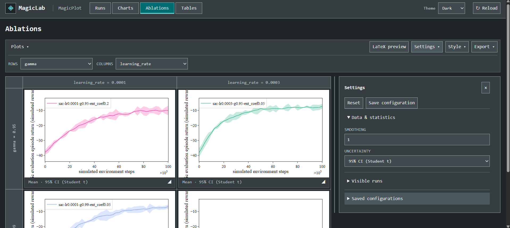
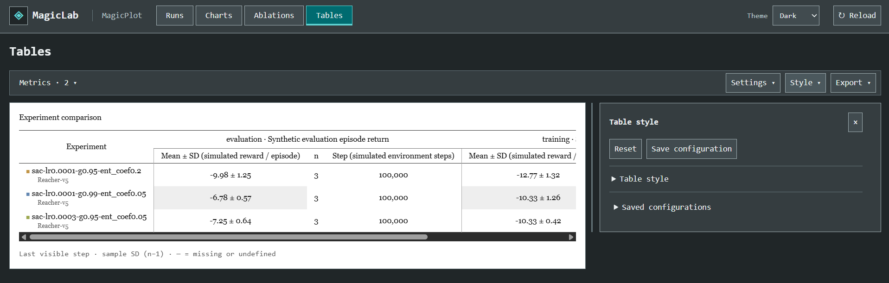
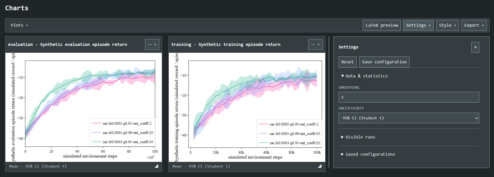

# MagicPlot design

Read the [shared design](../DESIGN.md) first. This guide owns MagicPlot-specific
visual and interaction rules. The embedded Dark screenshots were supplied on
October 10, 2026; dimensions describe image files, and some views are cropped.

## Main implemented features

- Runs catalogue with typed metadata filters, filter ordering, paginated values/rows and individual/group selection.
- Strict seed-replica grouping or explicit metadata grouping, with per-run configuration and artifact metadata.
- Multiple metric charts, configurable row/column ablation matrices and last-visible-step summary tables.
- Smoothing and uncertainty choices: sample SD multiples or pointwise 95% Student t confidence intervals, with effective seed counts and missing-value handling.
- Plot pan, XY/X/Y zoom, reset, fullscreen, chart reorder and pointer/keyboard resizing.
- Publication style controls for typography, axes/ranges, colors, labels, lines, markers, legends, series visibility and export dimensions.
- Browser session restoration, saved Settings/Style/Export configurations, reset actions and dataset reload.
- Per-chart or combined/separate PNG, SVG, PDF, CSV and LaTeX exports; optional compiled LaTeX previews with a local compiler.

This inventory describes the current UI. Portable view/reproduction formats and
lower-level APIs are documented separately in [data-contract.md](../data-contract.md).

## Writing style

Apply the [shared writing rules](../DESIGN.md#writing-style). Use compact technical
labels and explanatory plain English in statistical notes.
Keep Runs, Charts, Ablations, Tables, Settings, Style and Export as stable labels.
Retain original run/metric names near editable labels so the source remains identifiable.
Describe statistics explicitly: mean, sample SD, confidence interval, effective n
and the visible step. Distinguish missing or undefined values from zero and synthetic
examples from real measurements. State units on axes and in figure metadata.
Figure captions explain the measurement and uncertainty without unsupported performance
claims. Errors and empty states identify the condition and a useful next action.

## Reference examples

Use [examples/magicplot](../../examples/magicplot/README.md) alongside this guide:

- [manifest.json](../../examples/magicplot/manifest.json) and `runs/<id>/`: complete synthetic run configurations and metric logs for filtering, seed groups and analysis views.
- [generate.mjs](../../examples/magicplot/generate.mjs): deterministic generation of the 108 Reacher runs.
- [CSV sources](../../examples/magicplot/legacy/manifest.json): an illustrative manifest and untouched source CSV.
- [export-example.mjs](../../examples/magicplot/export-example.mjs): a saved view and publication export example; outputs stay outside the module.

Open the references with `npm --prefix magic_lab start -- --examples` from the
host root. Consult their structure and presentation when adapting the dashboard,
then connect actual host data as described in [ADAPTATION.md](../ADAPTATION.md).
Algorithms, factors, metric names and values in examples are not fixed UI requirements.
The runs are synthetic; neither the data nor screenshots establish real training.

## Scientific figures

Figures have white backgrounds even in Dark theme, scientific typography distinct
from the frame, explicit axes and units, concise legends and consistent series
colors. Also distinguish series through dashes or markers. Avoid decorative 3D.
Defaults are defined in [paper-style.mjs](../../core/paper-style.mjs): Computer
Modern, 10 pt font, 0.7 pt lines, 0.22 band opacity, grid off and axes box on.
These are configurable defaults; preserve user choices across views and exports.

## Runs

Runs owns filters, the compact catalogue and shared selection. Catalogue columns
follow filter order, including constant fields. Selected fields use a textual
indicator and teal tint. Reorder filters by dragging their names or using arrows.
Expand groups into individual runs; configurations and artifacts belong to each
run, not a representative member. Selection persistence follows
[STATISTICS.md](../STATISTICS.md#selection-and-grouping).

Show up to 100 catalogue rows per page, including expanded members, and 60 options
per page for filters with many values. Arrows and counters use shared controls.
The header checkbox selects all filtered runs across pages; group selection affects
all filtered members. Use compact desktop rows and at least 44 px touch targets.

_1915 x 931 px. Compact header, rectangular navigation, small filter panels and a
dense catalogue. Checkboxes, row tint and seed controls all indicate selection.
Filter count and columns depend on data. The Windows taskbar is outside the app._

_348 x 432 px crop. An anchored rectangular menu with a uniform surface, visible
border and spaced text entries. Property names depend on the source data._

## Charts and plot selection

Navigation exposes Runs, Charts, Ablations and Tables. Analysis views use the
available area with Plots (Charts), Plot: (Ablations), Metrics (Tables), Settings,
Style and Export. Charts uses large cards with draggable titles, per-metric export
and pointer/keyboard resizing. Plots toggles charts by metric. Ablations uses a
Plot: dropdown showing the current metric and selecting one chart. Size it to
show full source labels; allow local horizontal scrolling on narrow screens. Use full
names and an accessible selection indicator. Available plots use Training step
on X without X/Y selectors. Reserve margins for multipliers and terminal ticks.

_1917 x 786 px. Horizontal toolbar, technical card headings, white figures and
dark statistical footers. Free space on the right is layout-dependent, not a
required empty column. Cropped axis labels are defects to avoid._

## Ablations

Arrange figures in a matrix with shared scales, horizontal column headings and
vertical row headings. The wheel scrolls the page even over plots. Activate
XY/X/Y zoom commands before dragging; pan, reset, zoom and fullscreen remain
accessible without hover. Edit series colors and legend names only in Style. Legends can be dragged to
change their position, or positioned through Style. Style changes apply across
cells, sessions and exports.

_1917 x 857 px. Rows/Columns selectors, adjoining white cells and matching footers.
The lower matrix is outside the crop; an empty cell may mean a missing combination.
Gamma and learning_rate are example factors, not fixed product columns._

## Tables

Use a white surface, serif typography, aligned values and readable multilevel
headings. Show one row per group and ordered metric columns: last visible step,
mean, sample SD and effective n. Missing values and undefined SD use a dash,
never zero. Confine horizontal scrolling to the table. Calculation rules belong
in [STATISTICS.md](../STATISTICS.md).

_1917 x 611 px. Subtle alternating rows, colored experiment symbols and a statistical
note below the table. Frame and controls remain monospaced. The panel does not
cover the table, and overflowing columns remain reachable._

## Settings and Style panels

Open one right panel at a time, reserving space beside figures. Initial width
uses the free area; resize from the left edge with a 280 px minimum and at least
320 px left for charts. Limit height to the remaining viewport. Expanded sections
grow to that limit, then scroll internally. Preserve scroll and focus on edits.

Keep the panel open during plot interaction. Close through its command, close
button, Escape or another menu. Arrange controls vertically, including X/Y axis
and layout sections; only short related fields may share a row. Presets stay below.

The handle supports drag, arrows (Shift for larger steps), Home/End, Escape and
pointer cancellation. Width is shared between Settings and Style during the
session, not saved in exported views. Below 800 px place the panel above charts
in the page flow, use full width and hide the handle; keep height/scroll limits.

Desktop cards and matrices fill the region left of the divider and resize with
the panel. Use 20 px between cards and 24 px in the divider area. Panel resizing
never changes exported figure dimensions.

_1917 x 690 px. The panel occupies its own region beside the divider. Its header,
close action, collapsible sections and compact fields remain visible. This crop
shows Settings, not Style; the absent main header is not a removal instruction._

Settings exposes Smoothing, Uncertainty when applicable and Visible runs, plus
Reset and saved configurations. Incomplete, Alignment and step intervals remain
in the view format without panel controls. Smoothing is numeric from 1 to 50,
step 1, editable by vertical dragging, arrows or typing; 1 disables smoothing.

Style headings and Visible runs retain original source names. Custom labels
stay in inputs and figures/exports. Each series uses a full-width Legend label
row, then Color, Marker and Line in three columns on the next row.

Labels & ranges retains the metric name and original axis names above editable
fields. Axis settings and number formats are metric-specific. Number format
sits beside Tick interval; omit Divide by and Power of ten controls.
Figure titles are empty by default. Charts, Ablations, LaTeX previews and exports
use only the title entered in Style; ablation factors never generate a title.

## Preview and export

LaTeX preview, before Settings, replaces content inside each existing chart card,
including Ablations cells. Compile each chart separately, independent of combined
or separate export. Add no extra panels, download links or scale controls. Tables
retains its table. Loading/errors appear inside the figure; Interactive restores
plot interactions. Technical setup belongs in [PREVIEW.md](../PREVIEW.md).

Export lists PNG, SVG, PDF, CSV and LaTeX directly, without a Files subsection.
Download as (combined/separate) belongs to general export; Export chart shows only
formats. The rendering/export modules are mapped in
[architecture](../ARCHITECTURE.md#file-map); compiler setup belongs to PREVIEW.md.

## Implementation and reference limits

[paper-style.css](../../web/paper-style.css) defines controls,
[paper-editor.mjs](../../web/paper-editor.mjs) defines the editor and
[paper-figure.mjs](../../web/paper-figure.mjs) applies figure style.
Screenshots illustrate geometry, not numerical validity or responsive verification.
Light theme, narrow screens and Charts with Style open have no screenshot here.
